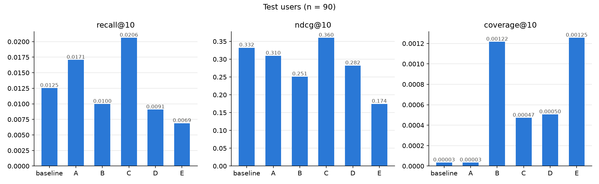
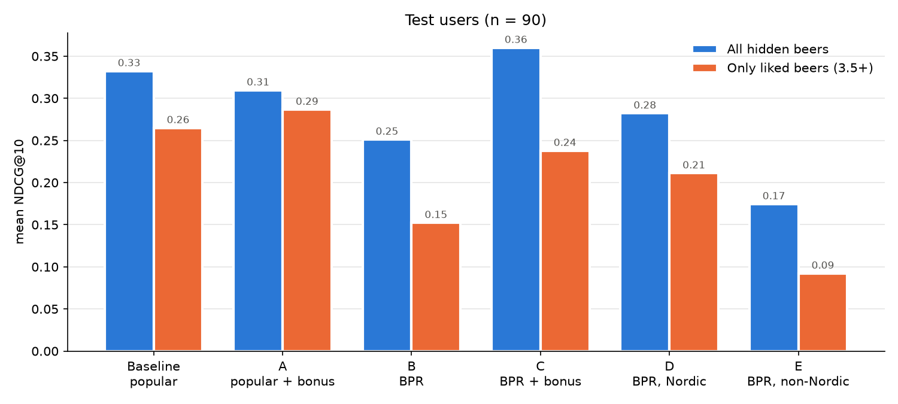

# Recommending Beer in a New Market

A school project in Business Intelligence. We build a system that recommends beers, using ratings from the
website RateBeer.

**The idea:** A beer app is launching in Norway. It has many users in other countries, but only a few in Norway.
Can it still give good recommendations to its Norwegian users?

This matters for business because a company entering a new market has little local data. If data from
other markets works, it can give good recommendations from day one.

## Research questions

- **RQ1:** Can data from other countries give good recommendations to new users in Norway?
- **RQ2:** Does it help to give extra weight to beers from Norway?
- **RQ3:** Does data from countries similar to Norway help more than data from other countries?

## Hypotheses

- **H1 (RQ1):** A model trained on other countries beats the general baseline recommendations.
- **H2 (RQ2):** The model from H1 gives better recommendations when Norwegian beers get a bonus in the ranking.
- **H3 (RQ3):** Data from Nordic users (Sweden, Denmark, Finland) helps more than the same amount of data from
  other countries.

## How to run

**1. Setup (only once).** Open a terminal in the project folder and run:

```
python3 -m venv .venv
source .venv/bin/activate
python setup_project.py
```

This installs everything and downloads the data. It takes a few minutes.
On Windows, use `python` instead of `python3` and `.venv\Scripts\activate` instead of `source .venv/bin/activate`.

**2. Run the notebooks in order:** 01 → 02 → 03 → 04. In VS Code, choose `.venv` as the kernel.
03 trains the models and takes about 20 minutes. The others take a minute or less.

## Data

RateBeer data from Lederrey & West (2018). It is not in the repo, but can be found under releases on GitHub, and `setup_project.py` downloads it.

**Permission:** Lederrey and West gave us permission by email to use the dataset in this project. The permission
is only for this project. To use the dataset for anything else, ask the owners by email:
robert.bob.west@gmail.com and glederre@gmail.com.

We keep ratings from 2010 to mid-2017 and find each user's and brewery's country from their location.
After cleaning there are about 4.9 million ratings from 36,700 users. 609 of the users are Norwegian.
1,951 users are from the other Nordic countries (Sweden 862, Denmark 716, Finland 373), with about 774,000
ratings in total. Run D is trained on these, plus the first 5 ratings of each Norwegian test user.

## How we test

1. **Training data:** all ratings from users outside Norway. The BPR models also get each test user's first
   5 ratings (see 3). The other Norwegian users (fewer than 15 ratings) are not used.
2. **Test users:** the 180 Norwegian users with at least 15 ratings.
3. The models only get each test user's **first 5 ratings**. The rest are hidden and used as the
   **answer key**.
4. The test users are split in two groups of 90: **validation** (to pick settings) and **test** (for the
   final numbers).

The hidden ratings are never used for training.

## Models

There are two models: **popularity** (the most rated beers) and **BPR** (learns which beers are liked by the
same people). The runs differ in training data or in a bonus.

| Run | What it is | Tests |
|---|---|---|
| Baseline | Most popular beers | (comparison point) |
| A | Baseline + bonus for Norwegian beers (same bonus as C) | Explains why C beats the baseline |
| B | BPR on all other countries | H1 |
| C | B + bonus for Norwegian beers | H2 |
| D | BPR on Nordic users only (not Norway) | H3 |
| E | BPR on other countries, same amount of data as D | H3 |

## Measuring

Each model gives every test user a top 10. We compare it with the user's hidden beers:
- **Recall@10:** how many of the hidden beers are in the top 10.
- **NDCG@10:** like recall, but hits at the top count more. Our main measure.
- **Coverage@10:** how many different beers are recommended in total (variety).

Every hidden beer counts as a hit, also ones the user rated low. As a check, we also score the models
with only the hidden beers rated 3.5 or higher (beers the user **liked**).

## Results



- Plain BPR (B) is worse than recommending the most popular beers (H1 rejected).
- A bonus for Norwegian beers makes BPR much better (H2 supported), and Nordic data beats the same amount of
  other data (H3 supported).
- C has the highest NDCG, but it is not significantly better than the popular list.
- Users with few ratings get the worst recommendations, and the Norwegian bonus mostly helps users who
  drink a lot of Norwegian beer ([failure analysis](results/failure_analysis.png)).



- When only beers the user liked count, H1–H3 still hold, but the popular lists are best.

See [04_results.ipynb](notebooks/04_results.ipynb) for all results and a summary. Tables and figures for the
report are in [results/](results/):

- [Main results](results/test_results.csv)
- [Hypothesis tests](results/hypothesis_tests.csv)
- [Baseline → A → C](results/bonus_steps.csv)
- [Check: only liked beers](results/liked_tests.csv)
- [Figure: only liked beers](results/liked_check.png)
- [Figure: all runs](results/metrics_by_run.png)
- [Figure: failure analysis](results/failure_analysis.png)
- [Figure: D vs. E](results/failure_analysis_d_vs_e.png)

## Folders

```
data/        the data (not in git)
notebooks/   the four notebooks
src/         code the notebooks use
results/     tables and figures for the report
```

## Limitations

- Country is a rough way to measure culture.
- We know where the user lives, not where they drank the beer.
- Beer country comes from the brewery. Beers brewed in Norway for foreign brands (e.g. Mikkeller at Lervig)
  count as Norwegian.
- People may drink local beer because it is what the shops sell, not because of taste.
- The data is from 2010–2017, and most users are from the US.
- Only 90 test users, so results can change a bit between groups.
- We tested a few settings on the validation users. For both the bonus (0 to 1.0) and the model size (32, 64
  and 128 factors), the largest value gave the best result. We did not try larger values, so they might work
  even better.
- The Nordic data (D) has fewer users with more ratings each than E. This may explain part of the difference.

## Dataset reference

Lederrey, G., & West, R. (2018). When Sheep Shop: Measuring Herding Effects in Product Ratings with Natural
Experiments. *Proceedings of The Web Conference (WWW 2018)*.
